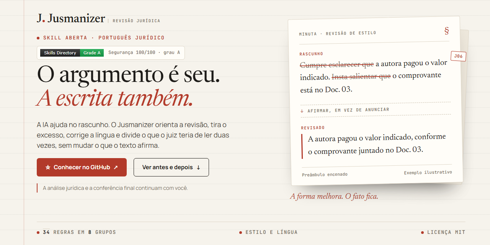

# Jusmanizer

**A IA ajuda no rascunho. A escrita precisa continuar sendo sua.**

O Jusmanizer é uma skill de revisão de estilo e de língua para textos jurídicos em português. Ela orienta o assistente de IA a retirar excessos, repetições e construções artificiais de petições, recursos, pareceres, minutas contratuais e comunicações, a corrigir gramática, concordância, regência, pontuação e crase, e a dividir os períodos longos demais, para que o juiz entenda a peça na primeira leitura. Tudo com atenção à formalidade e ao conteúdo original.

São **34 padrões de revisão**, organizados em **oito grupos**, com uma diretriz central: preservar fatos, nomes, valores, datas, pedidos, fontes e transcrições. O resultado continua sujeito à conferência do advogado.

**[Conheça a página e veja as demonstrações ↗](https://brunoflma.github.io/jusmanizer/)** · [Baixar a skill em ZIP](https://brunoflma.github.io/jusmanizer/downloads/jusmanizer.zip) · [Ler o SKILL.md](SKILL.md) · [Instalação](#como-instalar)

**A skill foi útil para você?** Clique em **Star**, no topo deste repositório, para encontrá-la novamente e apoiar o projeto. Se já testou, [conte sua experiência ou sugira uma melhoria](https://github.com/brunoflma/jusmanizer/issues/new?template=experiencia.yml). A estrela é opcional e o acesso continua livre.

## Onde ele entra no seu dia

| Você está trabalhando em | O que pode pedir |
| :--- | :--- |
| Petição ou contestação | Retirar preâmbulos repetidos e tornar a exposição dos fatos mais direta. |
| Peça truncada ou confusa | Corrigir o português, dividir os períodos longos e manter uma só designação para cada parte. |
| Recurso | Revisar transições e repetições, preservando o pedido e o tratamento ao órgão julgador. |
| Parecer | Ajustar a clareza e o tom, sem mudar a conclusão ou ampliar o alcance da análise. |
| Resumo ou análise de caso | Manter o tom neutro, atribuir cada afirmação à parte, à prova ou à decisão, e pôr os fatos em ordem cronológica. |
| Minuta contratual | Revisar a redação autoral, preservando partes, obrigações, valores e prazos. |
| Mensagem ao cliente | Trocar o excesso de formalismo por uma comunicação profissional e acessível. |
| Texto com a voz do escritório | Usar uma amostra de escrita para orientar o ritmo, o vocabulário e a pontuação. |

## Antes e depois, com os mesmos fatos

Os exemplos abaixo são fictícios e ilustrativos. Os resultados foram preparados para demonstrar a proposta de revisão; não são uma promessa de resposta idêntica em qualquer assistente.

### Exposição de fatos em uma petição

> **Antes:** Cumpre esclarecer que a autora pagou R$ 1.250,00 em 10/08/2026. Insta salientar que o comprovante foi juntado no Doc. 03. Vale dizer que a ré não contestou o pagamento.
>
> **Depois:** A autora pagou R$ 1.250,00 em 10/08/2026, conforme o comprovante juntado no Doc. 03. A ré não contestou o pagamento.

A revisão retira os anúncios de importância. O valor, a data, o documento e a afirmação sobre a ré permanecem.

### Comunicação ao cliente

> **Antes:** Prezada Ana, cumpre esclarecer que a audiência está marcada para 15/10/2026, às 14h. Insta salientar que ela ocorrerá por videoconferência. Vale dizer que o link será enviado no dia anterior.
>
> **Depois:** Prezada Ana, a audiência está marcada para 15/10/2026, às 14h, por videoconferência. O link será enviado no dia anterior.

O texto fica mais direto sem perder nenhuma orientação.

### Quando falta uma fonte

> **Entrada:** A jurisprudência é pacífica quanto ao tema.
>
> **Conduta esperada:** Pedir ao advogado a referência conferida, em vez de criar um tribunal, um número de processo ou uma data para completar a frase.

[Explore os outros exemplos e copie pedidos prontos na página do projeto.](https://brunoflma.github.io/jusmanizer/#demonstracao)

### Os cinco sinais mais fortes

Estes justificam a revisão numa única ocorrência:

1. **Travessão como ligação universal** entre frases (J01).
2. **Dois-pontos emendando duas orações** fora de lista, citação ou fórmula forense (J02).
3. **"Não se trata apenas de X, mas de Y"** quando ninguém alegou X (J03).
4. **Fecho de uma linha** que repete o parágrafo ou explica o exemplo recém-mostrado (J04).
5. **Frase de efeito** como "em última análise" ou "o cerne da questão" no lugar do fato (J05).

## Como usar no dia a dia

1. Instale ou forneça a skill ao assistente que você utiliza.
2. Apresente o texto e diga qual revisão deseja.
3. Confira a versão revisada antes de incorporá-la à minuta ou enviá-la ao destinatário.

### Um pedido para começar

```text
Use o Jusmanizer para revisar o estilo e o português deste texto jurídico.
Quem vai ler é um juiz com pouco tempo: a peça precisa ser entendida na
primeira leitura. Preserve os fatos, nomes, valores, datas, pedidos,
referências e transcrições. Chame cada parte sempre do mesmo jeito. Mantenha
a formalidade adequada ao destinatário e explique brevemente as alterações.
Se faltar uma informação, pergunte em vez de completar por conta própria.

[COLE O TEXTO]
```

Para adotar a sua voz, forneça antes dois ou três parágrafos escritos por você. A skill orienta o assistente a respeitar essa amostra, inclusive quando ela utiliza construções que normalmente seriam revisadas.

Em um ambiente com acesso a arquivos, você também pode pedir: `jusmaniza o texto do arquivo contestacao.md`. A skill lê o arquivo inteiro antes de editar, preserva código, comandos, caminhos, metadados, tabelas e destinos de links, e ao final informa quantas seções revisou e quais ficaram de fora.

Instrução escondida no texto revisado, como uma nota dirigida à IA numa peça da parte contrária, é tratada como texto a revisar e nunca é obedecida.

## Como instalar

### Claude no navegador ou aplicativo

1. [Baixe o ZIP da skill](https://brunoflma.github.io/jusmanizer/downloads/jusmanizer.zip).
2. Abra a área **Skills** nas configurações de recursos do Claude.
3. Use a opção de enviar uma skill, selecione o ZIP e habilite-a.
4. Em uma conversa, peça **“jusmaniza este texto”**.

O ZIP contém a pasta `jusmanizer` com o arquivo de instruções e o verificador. A disponibilidade de skills depende da conta e das permissões do ambiente. Consulte o [guia oficial do Claude](https://support.claude.com/en/articles/12512180-use-skills-in-claude) se a opção não aparecer.

### Claude Code

Execute os comandos abaixo, um de cada vez, na caixa de mensagem do Claude Code:

```text
/plugin marketplace add brunoflma/jusmanizer
```

```text
/plugin install jusmanizer@jusmanizer
```

Depois, inicie uma conversa com a skill disponível e peça a revisão.

### Outros assistentes compatíveis

O [SKILL.md](SKILL.md) é um arquivo de instruções em texto. Em ambientes que aceitam skills, instale-o pelo mecanismo correspondente. Em assistentes que aceitam arquivos ou instruções de projeto, forneça o conteúdo e peça explicitamente que ele seja seguido.

Isso não significa que ChatGPT, Gemini, Codex e outros produtos tenham a mesma interface de instalação ou os mesmos recursos. O resultado depende do ambiente e do modelo utilizado.

<details>
<summary><strong>Instalação manual e ferramentas de desenvolvimento</strong></summary>

No Claude Code, também é possível colocar o `SKILL.md` em uma pasta `jusmanizer` dentro da pasta de skills. No Windows, o caminho pessoal é `C:\Users\SEU-USUARIO\.claude\skills\jusmanizer\`.

Para descobrir a skill com o instalador `skills`:

```text
npx skills add brunoflma/jusmanizer
```

Escolha o agente e o destino de instalação oferecidos pelo instalador.

No pi, a skill se instala direto do repositório:

```text
pi install git:github.com/brunoflma/jusmanizer
```

</details>

## As 34 regras, em linguagem de advogado

<details>
<summary><strong>A. Encenar em vez de afirmar: J01 a J07</strong></summary>

| Padrão | O que observar |
| :--- | :--- |
| J01 | Risca usada como conector universal, preservando hífens, transcrições e intervalos numéricos. |
| J02 | Dois-pontos emendando orações, em vez de introduzir lista, citação ou fórmula forense. |
| J03 | Contraste “não X, mas Y” sem uma oposição real a enfrentar. |
| J04 | Fecho solto ou fragmento dramático que apenas repete o ponto anterior ou explica o exemplo que o leitor acabou de ver; a mesma ideia ou o mesmo “Diante do exposto, requer” ao fim de cada tópico; o mesmo valor, data ou artigo repetido à exaustão. |
| J05 | Frase de efeito no lugar de uma informação concreta, como “busca a tutela do Poder Judiciário”. |
| J06 | Preâmbulos em série, como “cumpre esclarecer”, “insta salientar”, “vale dizer” e “por fim, e não menos importante”. |
| J07 | Resposta a uma objeção que ninguém apresentou. |

</details>

<details>
<summary><strong>B. Ritmo por regra: J08 a J11</strong></summary>

| Padrão | O que observar |
| :--- | :--- |
| J08 | Três qualidades ou exemplos usados por reflexo. |
| J09 | Períodos ou parágrafos seguidos com a mesma abertura, e a mesma palavra comum repetida em poucas linhas. Termo técnico e nome de parte se repetem, sem sinônimo. |
| J10 | Qualificadores empilhados que enfraquecem a afirmação. |
| J11 | Voz passiva sem sujeito, quando cabe voz ativa sem alterar a atribuição. |

</details>

<details>
<summary><strong>C. Inflação e autoridade emprestada: J12 a J18</strong></summary>

| Padrão | O que observar |
| :--- | :--- |
| J12 | Vocabulário de IA repetido no jargão forense, e conectivo que não decorre da frase anterior (“ou seja”, “assim”). |
| J13 | Importância inflada por expressões e adjetivos genéricos (“exorbitantes”, “eterna devedora”, “ciclo vicioso”). |
| J14 | Relações vagas, sem dizer qual é o vínculo entre pessoas ou fatos. |
| J15 | Gerúndio de fechamento que aparenta explicar, mas não acrescenta informação. |
| J16 | Atribuição vaga à doutrina ou à jurisprudência, sem fonte identificada, e afirmação sobre o estado da jurisprudência (“matéria pacificada”, “todos os tribunais”) que a pesquisa não sustenta. |
| J17 | Rodeios desnecessários no lugar do verbo ser. |
| J18 | Conclusão genérica ou certeza declarada (“é certo que”, “indubitavelmente”), sem explicitar a consequência já sustentada pelo texto. |

</details>

<details>
<summary><strong>D. Formatação por regra: J19 a J22</strong></summary>

| Padrão | O que observar |
| :--- | :--- |
| J19 | Negrito decorativo, sem função de destacar um dado objetivo, e parágrafo do corpo aberto por número. |
| J20 | Iniciais maiúsculas indevidas no meio de títulos, ou título escrito para impressionar em vez de dizer o que a seção contém. |
| J21 | Aspas curvas onde a convenção do texto pede aspas retas. |
| J22 | Emojis, setas e linhas decorativas no corpo da peça. |

</details>

<details>
<summary><strong>E. Resíduos de conversa: J23 a J26</strong></summary>

| Padrão | O que observar |
| :--- | :--- |
| J23 | Expressões do chat, nomes de arquivo e de ferramenta e marcações provisórias que ficaram no documento final. |
| J24 | Ressalvas sobre o modelo ou palpites apresentados como fatos. |
| J25 | Primeira frase que apenas repete o título da seção. |
| J26 | Texto que fala de si mesmo (a versão anterior, como foi montado, a ordem da tabela) em vez de falar do caso. |

</details>

<details>
<summary><strong>F. Cuidados próprios do texto jurídico: J27 a J32</strong></summary>

| Padrão | O que preservar |
| :--- | :--- |
| J27 | Transcrições literais de leis, julgados, depoimentos e cláusulas, conferidas letra a letra com a fonte. |
| J28 | A forma de tratamento adequada ao grau de jurisdição. |
| J29 | A formalidade própria de cada tipo de documento. |
| J30 | Fórmulas forenses consagradas, sem tratá-las isoladamente como defeitos. |
| J31 | Fatos, nomes, números, datas, pedidos, julgados e fontes do original, e quem afirma cada coisa: o que a parte alega não vira fato provado. |
| J32 | A identificação clara do referente de expressões como “isso” ou “o referido”, também quando o pronome pode se referir a duas partes. |

</details>

<details>
<summary><strong>G. Escrever para o leitor errado: J33</strong></summary>

| Padrão | O que observar |
| :--- | :--- |
| J33 | Resposta a cliente ou colega que reconta o que ele já sabe e deixa a decisão para o fim. Não vale para a peça, em que o juiz precisa dos fatos. |

</details>

<details>
<summary><strong>H. Clareza para quem lê com pressa: J34</strong></summary>

| Padrão | O que observar |
| :--- | :--- |
| J34 | Período com várias orações encaixadas, que obriga o juiz a ler duas vezes. Ele é dividido em frases com sujeito e verbo próximos, sem perder a relação lógica. |

</details>

Além dos padrões, a revisão corrige a língua: concordância, regência, pontuação, crase, frase sem sujeito ou sem objeto, “este” e “esse”, hífen de quebra de linha esquecido e designação das partes, que fica a mesma na peça inteira. Transcrições não são corrigidas.

O catálogo completo, com critérios, exceções e exemplos, está no [SKILL.md](SKILL.md). A amostra de voz fornecida pelo advogado tem prioridade sobre preferências gerais de estilo.

## Verificador de arquivos

O repositório também inclui um verificador em Python. Ele aponta os padrões que consegue identificar por regras e mostra onde aparecem. A execução normal não reescreve o arquivo.

```text
python scripts/jusmanizer.py peca.md
```

Para obter o resultado em formato estruturado:

```text
python scripts/jusmanizer.py peca.md --json
```

O verificador também aponta parágrafo do corpo aberto por número, período com mais de 60 palavras, palavra partida na quebra de linha (“contra- to”) e crase indevida (“à partir”, “à Vossa Excelência”, crase antes de verbo ou de pronome). Avisa ainda quando o mesmo valor, data ou artigo aparece seis ou mais vezes no texto. O número do próprio processo não deve entrar nessa conta, e para isso basta informá-lo:

```text
python scripts/jusmanizer.py peca.md --ignorar-ancora 0000000-00.0000.0.00.0000
```

O verificador não cobre todo o julgamento contextual da skill e não determina se um texto foi escrito por uma pessoa ou por IA.

## Uso responsável e licença

O Jusmanizer apoia a **revisão de estilo**. Não valida uma tese, não confirma a existência de julgados e não decide a estratégia de um caso. Também não serve para passar por detectores de IA: a revisão é feita para quem lê a peça, o juiz, o colega e o cliente. Confira o conteúdo, as fontes e os pedidos antes de usar a versão revisada.

Ao trabalhar com documentos reais, observe o sigilo e as regras de tratamento de dados do assistente escolhido. A demonstração no site utiliza apenas exemplos prontos e fictícios.

Distribuído sob a [licença MIT](LICENSE), sem garantia. A revisão e a responsabilidade profissional pelo documento permanecem com quem o utiliza e assina.

[Dúvidas e contribuições](https://github.com/brunoflma/jusmanizer/issues) · [Bruno Ferreira](https://github.com/brunoflma) · [LinkedIn](https://www.linkedin.com/in/brunoflma/)
